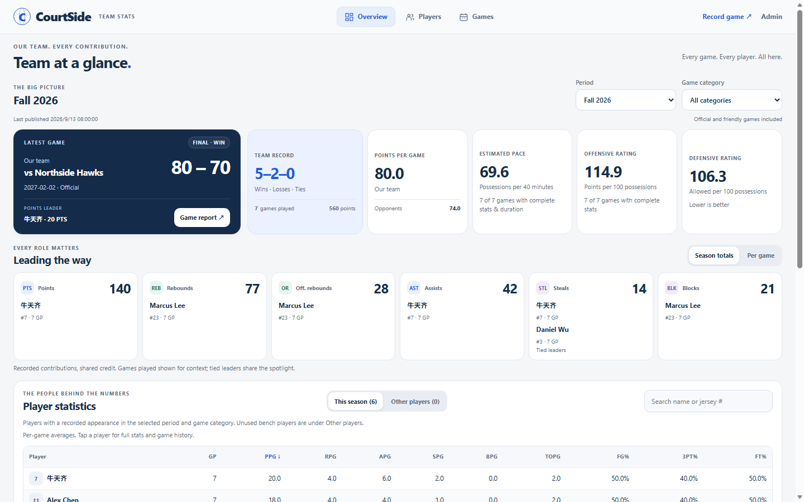
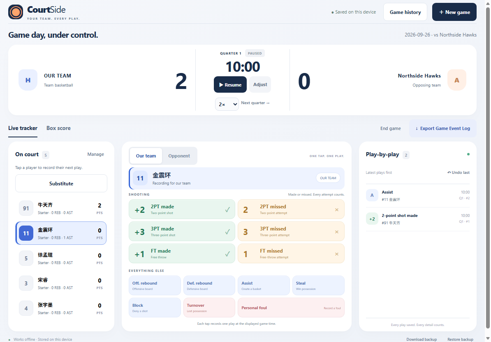
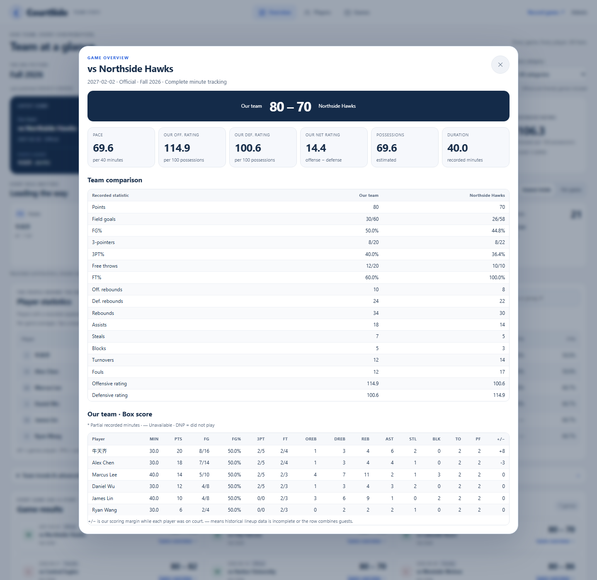
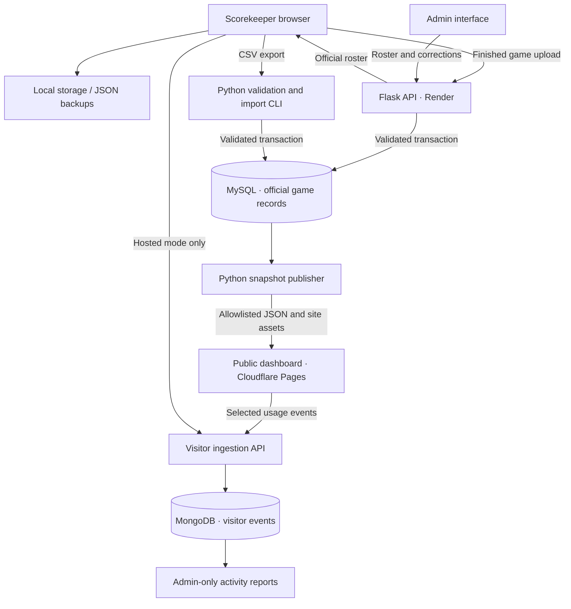

# CourtSide

**An end-to-end basketball data platform: from courtside capture to trustworthy analytics.**

I built CourtSide for a university basketball team to record games, maintain an official history, and explore player and team performance. The project connects offline event capture, Python ingestion, SQL data modeling, a Flask API, public dashboards, and MongoDB visitor analytics.

**My scope:** data contracts, database design, ingestion and correction workflows, metric definitions, frontend and backend implementation, testing, and cloud deployment.

[**Live dashboard**](https://courtside-team.pages.dev/) · [**Scorekeeper**](https://courtside-team.pages.dev/Front) · [Architecture](#architecture) · [Engineering decisions](#engineering-decisions) · [Try-it-yourself](#try-it-yourself)

## What this project demonstrates

| Capability | Evidence in this project |
| --- | --- |
| **Data engineering** | Validate complete uploads before writing; use transactions, stable identities, duplicate-safe imports, and versioned corrections to maintain reliable records. [Ingestion code](scorekeeper_pipeline/database.py) · [SQL schema](sql/schema.sql) |
| **Analytics and statistical reasoning** | Define the right unit of analysis, calculate weighted rates, distinguish missing values from zero, and restrict estimates to sufficiently complete data. [Calculations](site/analytics.js) · [Metric definitions](docs/public-dashboard.md#metric-definitions) |
| **Product thinking** | Design distinct workflows for scorekeepers, administrators, and viewers; support unreliable connectivity and video-based recording; instrument usage to inform future improvements. [Recording guide](docs/scorekeeper-guide.md) · [Visitor analytics](docs/visitor-activity.md) |
| **Engineering reliability** | Preserve retry payloads, audit corrections, recover from publication failures, and test failure cases across the browser, API, and database layers. [Repository logic](scorekeeper_remote/repository.py) · [Tests](tests) |

**Stack:** Python · SQL / MySQL · MongoDB · Flask · JavaScript · Docker · Render · Cloudflare Pages

**Live dataset, verified November 15, 2026:** 8 published games and 37 roster records.



*Screenshots use demonstration data and show the implemented interface. The live dashboard contains the published team records.*

## The product and its users

- **Scorekeepers** record 13 types of game events, manage substitutions and playing time, and correct mistakes. Local saving and JSON backups support recovery; the standalone recorder works offline. Adjustable clock speeds support recording from video.
- **Administrators** maintain the official roster, review and correct uploaded games, and publish updated statistics through a separate authenticated workflow.
- **Players and visitors** explore season, year, and career summaries, player profiles, shooting splits, and individual game reports without signing in.

The public dashboard updates after a game is uploaded and published. Browser-based game recording is live; public results are published snapshots.

<details>
<summary><strong>See the recording and game-report interfaces</strong></summary>



The recorder keeps the original time and lineup when a statistical event is corrected, allowing affected statistics to be recalculated.



Game reports include player plus/minus when complete lineup history is available.

</details>

## Architecture



MySQL stores the official basketball records. Each play has a composite `(game_id, event_id)` key; participation records track each player's appearance and minutes, and lineup snapshots support historical plus/minus. See the [core schema](sql/schema.sql) and [remote extensions](sql/remote.sql).

The public dashboard reads a static JSON snapshot, keeping public reads independent of backend availability. MongoDB stores optional usage events separately, with its own retention policy. Visitor reports are accessible only through authenticated admin endpoints.

## Engineering decisions

### 1. Make repeated uploads safe

A courtside connection can fail after the server has accepted a game. The client therefore retains the exact pending payload for a retry, and the server recognizes an unchanged submission.

For CSV imports, the entire file is validated before any database write. An InnoDB transaction and game-row locking protect the import; conflicting event contents roll back the batch. Reimporting a game does not double its score, and an older CSV cannot reactivate a voided event.

**Inspect:** [Validation](scorekeeper_pipeline/validation.py) · [Transactional imports](scorekeeper_pipeline/database.py) · [Upload client](src/remote.js)

### 2. Preserve history through corrections

Player IDs remain stable when names, jersey numbers, or roster membership change. Event and participation records retain historical attributes.

Administrator corrections require the expected game version, preventing stale edits from silently replacing newer records. Prior documents are retained in an audit table. Participation snapshots also carry a revision and content hash to reject stale or conflicting updates.

**Inspect:** [Correction and audit logic](scorekeeper_remote/repository.py) · [Roster and participation model](docs/roster-lineups.md)

### 3. Separate a successful save from a successful publication

Saving a game and publishing the website are separate outcomes. If publication fails, the database retains the committed game and marks publication as pending. An administrator can retry publishing without submitting the game again.

The publisher selects explicitly allowed public fields. Upload documents, audit history, credentials, and visitor activity are excluded from the public statistics snapshot.

**Inspect:** [Publication state](scorekeeper_remote/repository.py) · [Public artifact builder](scorekeeper_remote/publishing.py)

## Analytics with explicit assumptions

| Analytical question | Implementation choice |
| --- | --- |
| What counts as a game played? | Count actual appearances, including zero-stat appearances; exclude unused bench players. |
| How should shooting rates be combined? | Divide total makes by total attempts instead of averaging game percentages. |
| Can every game contribute to pace and efficiency? | Require sufficient recording completeness; pace also requires reliable duration. Weight aggregate ratings by possessions and pace by duration. |
| What does missing history mean? | Preserve unavailable values and label partial minutes. Do not infer historical lineups. |
| What can plus/minus support? | Calculate it from the lineup saved at each scoring event and display it in individual game reports when coverage is complete. |

A practical data-quality decision: the first recorded game's unreliable duration is treated as unavailable. It remains in basic statistics but is excluded from pace calculations.

**Product usage analytics** adds anonymous page views, player/game opens, selected actions, and approximate active time. Event IDs make retries duplicate-safe; MongoDB applies a 90-day retention policy. Browser opt-out and DNT/GPC signals are respected. Reports distinguish browser/session counts from people and document measurement limits.

Visitor collection is enabled on the hosted deployment; local builds default to disabled. See the [event contract, reporting definitions, and privacy controls](docs/visitor-activity.md).

Current analytical work covers descriptive statistics and product usage measurement. Predictive modeling, causal inference, and validated product experiments are future work.

## Verification

Verification recorded on **November 15, 2026**, against application code at `3deee12`:

| Check | Result |
| --- | --- |
| JavaScript suite, including two browser-driven checks | **85 passed** |
| Python discovery | **57 passed; 31 database integration tests skipped** |

The database tests require isolated MySQL/MongoDB instances and were not rerun during that review. Earlier integration and end-to-end results are documented in the [visitor verification record](docs/visitor-activity-verification.md). The latest release context is in the [deployment handoff](docs/superpowers/plans/2026-11-13-session-handoff.md).

Tests cover duplicate and conflicting imports, rollback, stale corrections, uncertain upload outcomes, zero-stat appearances, missing metrics, visitor deduplication, and access restrictions. A separate dashboard browser suite has a documented reduced-motion failure; it is not included in the passing results above.

```sh
node --test tests/*.test.cjs
python -m unittest discover -s tests
```

Use a current Node.js runtime; Node.js 24 and Python 3.12 match the container configuration. The JavaScript suite includes headless browser checks using Microsoft Edge on Windows or a Chromium executable configured with `EDGE_PATH`. Python dependencies are listed in `requirements.txt`. See the [deployment guide](docs/remote-deployment.md#working-locally) for test setup and the [visitor guide](docs/visitor-activity.md#local-verification) for isolated MongoDB testing.

## Try it yourself

### Record a game locally

```sh
git clone https://github.com/BarryNiu-Wahaha/courtside-scorekeeper.git
cd courtside-scorekeeper
python -m http.server 8000 --bind 127.0.0.1
```

Open **http://127.0.0.1:8000/Front.html**. Select a squad and five starters, start the clock, and record plays. Local recording requires no database or API credentials. The standalone `Front.html` can also be opened directly in a desktop browser.

### Inspect the ingestion pipeline

Export an event CSV from a locally recorded game, then validate it:

```sh
python -m pip install -r requirements.txt
python -m scorekeeper_pipeline validate path/to/game_events.csv
```

Validation runs without a database connection. The [pipeline guide](docs/mysql-pipeline.md) covers local MySQL setup, imports, migrations, and analytical queries.

### Explore the implementation

| Directory | Responsibility |
| --- | --- |
| [scorekeeper_pipeline/](scorekeeper_pipeline) | CSV contracts, validation, import CLI, and MySQL transactions |
| [scorekeeper_remote/](scorekeeper_remote) | Flask API, authentication, corrections, publication, and MongoDB visitor reporting |
| [sql/](sql) | Relational schemas, migrations, and analytical queries |
| [src/](src) | Recording engine, lineups, persistence, and upload behavior |
| [site/](site) | Public analytics, administration, and visitor instrumentation |
| [tests/](tests) | Unit, API, database integration, and browser checks |

Edit the recorder in `src/` and regenerate `Front.html` with `node build.cjs`.

[User guide](docs/scorekeeper-guide.md) · [API guide](docs/remote-api.md) · [Cloud deployment](docs/remote-deployment.md) · [Design decisions](docs/superpowers/specs)
